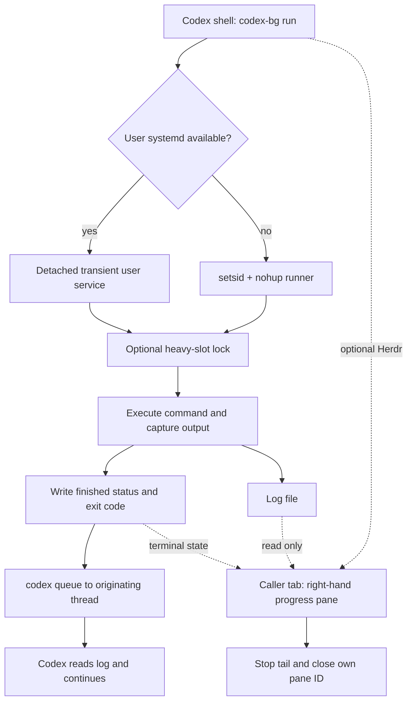

# How codex-bg works / 运行原理

The launcher, runner, and viewer have separate lifetimes. Codex starts a job and
can end its turn. The job does not live inside the terminal that displays it.

启动器、执行器、查看器的生命周期分开：模型只负责启动和处理结果，执行器负责等待命令，
查看器负责展示日志。关闭查看器不会结束后台命令。



## 1. Launch and identity

`run` captures `CODEX_THREAD_ID`, the current working directory, the resolved
`codex` executable, and command arguments. It sanitizes the label and appends a
second-resolution timestamp to form `codex-bg-NAME-YYYYMMDD-HHMMSS`.

The launcher creates the log and starting status **before** opening a pane.
In systemd mode it rejects an already-active job with the same label. This check
is not an atomic, global scheduler lock; avoid concurrent launches of the same
name. The fallback has no duplicate-name check.

Each job stores:

| File | Contents |
| --- | --- |
| `UNIT.log` (or `--log`) | Command stdout and stderr |
| `UNIT.status` | First line: lifecycle status; subsequent lines may contain queue output |
| `UNIT.json` | Log path, launch directory, and optional pane ID; requires jq |
| `UNIT.runner.log` | Runner diagnostics in setsid fallback mode |
| `heavy.N.lock` | Shared file locks for participating heavy jobs |

The default directory is `/tmp/codex-bg`. Files are not a persistent queue or a
database, and `list` does not reconcile every status with live processes.

## 2. Detached execution

With a usable user systemd manager, `systemd-run` starts a transient service for
the runner. With `--mem`, the command runs inside a child scope with `MemoryMax`
and `MemorySwapMax=0`; the runner itself is outside that cap so it can record an
OOM-related command failure. Exit 137 is logged as a *possible* memory kill,
not proof of one.

Without user systemd, `setsid nohup` detaches the runner. This path has no memory
cap or supported `stop` implementation. It is a reduced fallback, not equivalent
process management. Neither mode promises survival across reboot or user-manager
shutdown.

`--heavy` acquires one of two `flock` slots before command execution. The runner
checks for an available slot every 15 seconds; this is local process waiting,
not a model call. Slots are scoped by the state directory, not by repository.

## 3. Completion and wake delivery

The runner records `state=finished`, the command exit code, and elapsed seconds
before submitting a message via:

```text
codex queue --thread <originating-thread> --message <result-and-log-location>
```

It attempts delivery up to three times, with a five-second delay after failed
attempts, and appends `wake=failed` if none succeeds. The runner's own exit code
represents notification delivery; the **command result is in the first status
line**. A successful queue operation can accompany a failed test command.

Messages can arrive late or remain queued for a closed session. The script does
not force `--resume`, route to a remote server, or guarantee exactly-once delivery.
Agents should match the unit to prior work before acting on a delayed message.

完成状态先写入磁盘，通知后发送；通知失败不抹掉任务结果。收到延迟通知时应先核对 unit，
不要把已经处理过的失败当成新的失败而盲目重跑。

## 4. Herdr pane ownership

The launcher uses the caller's Herdr context and splits to the right, preserving
tab, directory, and focus. It reads the new pane ID from Herdr's JSON response,
stores it in metadata, and passes that exact ID to the viewer. It never chooses
another client's focused pane as a fallback.

The pane runs only `watch`, which follows the log and samples the status file.
When it observes `finished` or `stopped`, it stops its `tail` child and calls
`herdr pane close ID`. The automatic viewer first requires that ID to match its
own `HERDR_PANE_ID`. It does not look up a possibly-replaced metadata ID when
closing. A manual `watch` has no close target.

The runner does not depend on the viewer. Closing the pane early or interrupting
the viewer cannot kill the detached task. Conversely, an interrupted viewer no
longer closes the pane automatically. Closing errors are best effort and do not
change task status or trigger retries of the workload.

## 5. Cancellation and trust

`stop` asks user systemd to stop the named unit, then writes `state=stopped`.
It intentionally sends no completion notification. It does not roll back command
side effects. Status files are not a cancellation API; editing a status file
does not stop a process.

This tool runs trusted commands as the current user. Command output and queue
diagnostics can contain sensitive data. Use a private state directory, pass
environment variable names rather than values in argv, and keep application
logging free of secrets. Do not use this helper as a sandbox.
