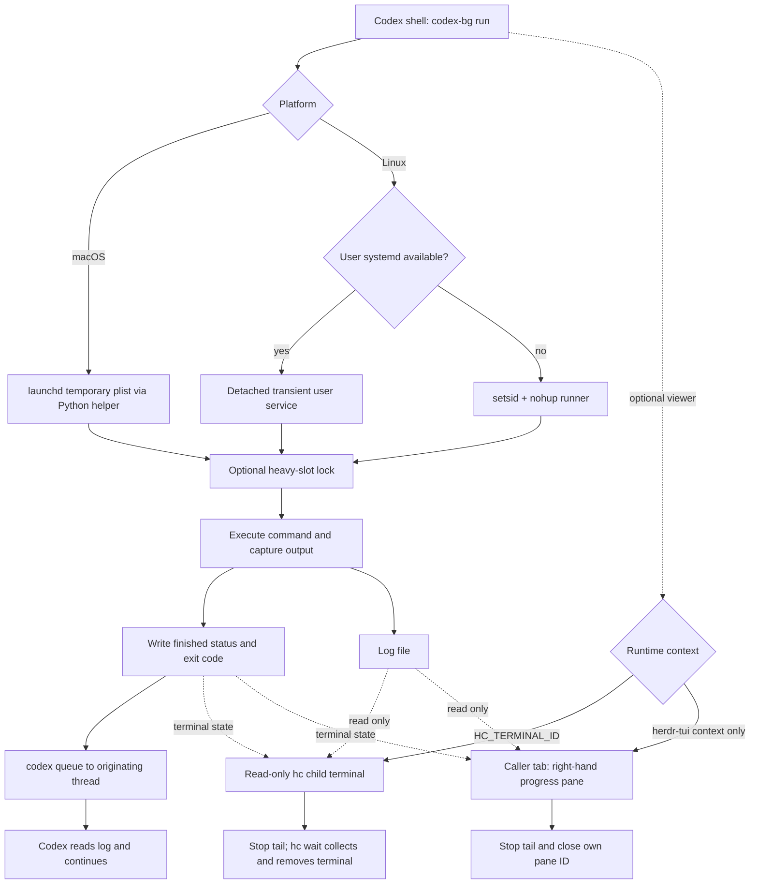

# How codex-bg works

[中文](how-it-works.zh-CN.md)

The launcher, runner, and viewer have separate lifetimes. Codex starts a job and
can end its turn. The job does not live inside the terminal that displays it.



## 1. Launch and identity

`run` captures `CODEX_THREAD_ID`, the current working directory, the resolved
`codex` executable, and command arguments. It sanitizes the label and appends a
second-resolution timestamp to form `codex-bg-NAME-YYYYMMDD-HHMMSS`.

The launcher creates the log and starting status **before** opening a viewer.
In systemd and launchd modes it rejects an already-active job with the same
label. This check is not an atomic, global scheduler lock; avoid concurrent
launches of the same name. The Linux setsid fallback has no duplicate-name check.

Each job stores:

| File | Contents |
| --- | --- |
| `UNIT.log` (or `--log`) | Command stdout and stderr |
| `UNIT.status` | First line: lifecycle status; subsequent lines may contain queue output |
| `UNIT.json` | Log path, launch directory, backend metadata, and optional terminal/pane ID |
| `UNIT.plist` / `UNIT.launch.json` | macOS launchd job definition and runner config (removed on `stop`) |
| `UNIT.runner.log` | Runner diagnostics (setsid fallback or launchd helper stdout/stderr) |
| `heavy.N.lock` | Shared file locks for participating heavy jobs |
| `name.NAME.lock` | macOS same-name admission lock |

The default directory is `/tmp/codex-bg`. Files are not a persistent queue or a
database, and `list` does not reconcile every status with live processes.

## 2. Detached execution

**Linux + user systemd.** `systemd-run` starts a transient service for the
runner. With `--mem`, the command runs inside a child scope with `MemoryMax`
and `MemorySwapMax=0`; the runner itself is outside that cap so it can record an
OOM-related command failure. Exit 137 is logged as a *possible* memory kill,
not proof of one.

**Linux without user systemd.** `setsid nohup` detaches the runner. This path
has no memory cap or supported `stop` implementation. It is a reduced fallback,
not equivalent process management.

**macOS + launchd.** `bin/codex-bg-macos.py` writes a temporary plist under the
state directory (`UNIT.plist`), bootstraps it with `launchctl` into `gui/$UID`
when that domain answers, otherwise `user/$UID`, and runs the same lifecycle as
the Linux runner (status lines, heavy slots, `codex queue`). `--mem` is rejected
up front. `fcntl.flock` replaces the `flock` CLI. Completion notification text
matches the Linux runner. This path is verified on GitHub `macos-latest`, not on
a personal Mac.

Neither backend promises survival across reboot or session teardown.

`--heavy` acquires one of two file-lock slots before command execution. On Linux
the runner polls every 15 seconds with `flock`; on macOS it polls more frequently
with Python `fcntl.flock`. This is local process waiting, not a model call.
Slots are scoped by the state directory, not by repository.

## 3. Completion and wake delivery

The runner records `state=finished`, the command exit code, and elapsed seconds
before submitting a message via:

```text
codex queue --thread <originating-thread> --message <result-and-log-location>
```

It attempts delivery up to three times, with a five-second delay after failed
attempts, and appends `wake=failed` if none succeeds. The runner's own exit code
represents notification delivery; the **command result is in the first status
line**. A successful queue operation can accompany a failed test command.

Messages can arrive late or remain queued for a closed session. The script does
not force `--resume`, route to a remote server, or guarantee exactly-once delivery.
Agents should match the unit to prior work before acting on a delayed message.
Write the finished status to disk before notifying; a failed wake does not erase
the command result. When a delayed message arrives, confirm the unit against
prior work before rerunning.

## 4. Viewer ownership

The current shell selects the viewer. A nonempty `HC_TERMINAL_ID` takes
precedence; otherwise `HERDR_ENV=1` plus `HERDR_PANE_ID` selects herdr-tui.
Neither context means detached logs only. Installed binaries do not select a
control plane.

### hc terminals

The launcher validates its caller with `hc get`, then starts a read-only child
using `hc run --bg --rm --no-notify --parent <caller>`. The metadata records
the returned `terminal_id`. A live terminal is reused only if its parent,
`codex-bg.unit`, and `codex-bg.role=viewer` labels match. An invalid caller
or failed viewer does not fall back to another herdr-tui session.

The child runs only `watch`. A detached collector waits for its exit with
`hc wait`, renewing waits after timeout/message check-ins without model calls.
When `watch` observes `finished` or `stopped`, it exits; the collector obtains
the exit and hc removes the `--rm` terminal. Linux detaches the collector with
`setsid`/`nohup`, while macOS uses `nohup`/`disown`. The latter requires no
GNU `setsid` and preserves the launchd workload's independent lifetime.

Closing a viewer early does not cancel the systemd/launchd task. Its
`--no-notify` suppresses duplicate parent notes; `codex queue` still reports
the actual task result. hc manages terminals rather than window placement.

### herdr-tui panes

The launcher uses the caller's herdr-tui context and splits to the right, preserving
tab, directory, and focus. It reads the new pane ID from herdr-tui's JSON response,
stores it in metadata, and passes that exact ID to the viewer. It never chooses
another client's focused pane as a fallback.

The pane runs only `watch`, which follows the log and samples the status file.
When it observes `finished` or `stopped`, it stops its `tail` child and calls
`herdr pane close ID`. The automatic viewer first requires that ID to match its
own `HERDR_PANE_ID`. It does not look up a possibly-replaced metadata ID when
closing. A manual `watch` has no close target.

The runner does not depend on the viewer. Closing the pane early or interrupting
the viewer cannot kill the detached task. Conversely, an interrupted viewer no
longer closes the pane automatically. Closing errors are best effort and do not
change task status or trigger retries of the workload.

## 5. Cancellation and trust

`stop` asks user systemd (Linux) or `launchctl bootout` (macOS) to stop the named
unit, then writes `state=stopped` when the job had not already finished. On
macOS it also deletes the temporary plist and launch config so forwarded
environment values do not linger. It intentionally sends no completion
notification. It does not roll back command side effects. Status files are not a
cancellation API; editing a status file does not stop a process.

This tool runs trusted commands as the current user. Command output and queue
diagnostics can contain sensitive data. Use a private state directory, pass
environment variable names rather than values in argv, and keep application
logging free of secrets. Do not use this helper as a sandbox.
