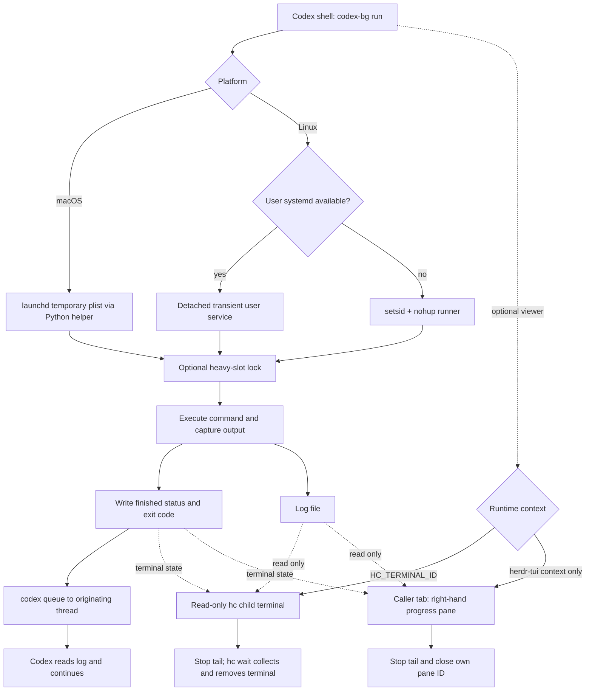

# codex-bg 运行原理

[English](how-it-works.md)

启动器、执行器、查看器的生命周期分开：模型只负责启动和处理结果，执行器负责等待命令，
查看器负责展示日志。关闭查看器不会结束后台命令。任务不运行在展示日志的那个终端里。



## 1. 启动与身份

`run` 会捕获 `CODEX_THREAD_ID`、当前工作目录、解析到的 `codex` 可执行文件，以及命令参数。
短名经过清洗后，再附上秒级时间戳，形成 `codex-bg-NAME-YYYYMMDD-HHMMSS`。

启动器在打开进度查看器**之前**先创建日志和起始状态。
在 systemd 与 launchd 模式下，若同名任务仍在运行会拒绝启动。
这不是全局原子调度锁；请避免并发启动同名任务。Linux 的 setsid 退回路径没有重名检查。

每个任务会写入：

| 文件 | 内容 |
| --- | --- |
| `UNIT.log`（或 `--log`） | 命令的标准输出与标准错误 |
| `UNIT.status` | 首行为生命周期状态；后续行可能含 queue 输出 |
| `UNIT.json` | 日志路径、启动目录、后端元数据，以及可选的 terminal/pane ID |
| `UNIT.plist` / `UNIT.launch.json` | macOS launchd 任务定义与 runner 配置（`stop` 时删除） |
| `UNIT.runner.log` | runner 诊断日志（setsid 退回或 launchd helper 的 stdout/stderr） |
| `heavy.N.lock` | 参与 heavy 限制的共享文件锁 |
| `name.NAME.lock` | macOS 同名准入锁 |

默认目录是 `/tmp/codex-bg`。这些文件不是持久队列或数据库；`list` 也不会把每条状态与存活进程逐一对账。

## 2. 脱离终端执行

**Linux + user systemd。** `systemd-run` 为 runner 启动瞬时用户服务。
使用 `--mem` 时，命令在带 `MemoryMax` 且 `MemorySwapMax=0` 的子 scope 中运行；
runner 本身不受该上限约束，以便在命令可能因 OOM 被杀时仍能记录结果。
退出码 137 会记为*可能*的内存限制杀死，不能当作确证。

**Linux 无 user systemd。** 用 `setsid nohup` 脱离 runner。
此路径没有内存上限，也没有可用的 `stop`。这是能力更少的退回方案，不等于完整进程管理。

**macOS + launchd。** `bin/codex-bg-macos.py` 在状态目录写入临时 plist（`UNIT.plist`），
用 `launchctl` 加载到 `gui/$UID`（该域不可用则用 `user/$UID`），并走与 Linux runner 相同的生命周期
（状态行、heavy 槽位、`codex queue`）。一开始就拒绝 `--mem`。
用 Python `fcntl.flock` 替代 `flock` 命令。完成通知文案与 Linux 一致。
该路径在 GitHub `macos-latest` 上验证，未在个人真机验证。

上述后端都不保证跨重启或会话结束仍存活。

`--heavy` 在执行命令前占用两个文件锁槽位之一。
Linux 上 runner 每 15 秒用 `flock` 轮询；macOS 上用 Python `fcntl.flock` 更频繁地轮询。
这是本地进程等待，不是模型调用。槽位按状态目录划分，不按仓库划分。

## 3. 完成与唤醒投递

runner 先写入 `state=finished`、命令退出码和耗时秒数，再通过以下方式投递消息：

```text
codex queue --thread <originating-thread> --message <result-and-log-location>
```

最多尝试三次，失败后等待五秒再试；若仍失败则追加 `wake=failed`。
runner 自身的退出码表示通知是否送达；**命令结果在状态文件首行**。
queue 成功可以伴随一次失败的测试命令。

消息可能延迟到达，或在会话关闭时继续排队。脚本不会强制 `--resume`、也不会路由到远端服务，
也不保证恰好一次投递。Agent 在处理延迟消息前，应先把 unit 与既有工作核对清楚。

完成状态先写入磁盘，通知后发送；通知失败不抹掉任务结果。
收到延迟通知时应先核对 unit，不要把已经处理过的失败当成新的失败而盲目重跑。

## 4. 查看器归属

按当前 shell 上下文选择查看器：优先使用非空的 `HC_TERMINAL_ID`，无 hc 上下文时才按
`HERDR_ENV=1` 与 `HERDR_PANE_ID` 选择 herdr-tui。两者都没有时仅保留后台日志，
不凭已安装的命令选择控制平面。

### hc 终端

启动器先用 `hc get` 验证调用者，再通过 `hc run --bg --rm --no-notify --parent <调用者>`
启动只读子终端，把返回的 `terminal_id` 写入元数据。只有存活状态、父终端、`codex-bg.unit`
与 `codex-bg.role=viewer` 标签都匹配时才复用。调用者验证或查看器创建失败时，
不会回退到另一个 herdr-tui 会话。

子终端只运行 `watch`。独立收集器用 `hc wait` 等待退出；超时或收到消息提前返回时重新挂起等待，
不调用模型。`watch` 观察到 `finished` 或 `stopped` 后退出，收集器取得退出结果，hc 清理 `--rm`
终端。Linux 收集器使用 `setsid`/`nohup`，macOS 使用 `nohup`/`disown`，不依赖 GNU `setsid`，
任务仍保持独立的 launchd 生命周期。

提前关闭查看器不会取消 systemd/launchd 任务。查看器的 `--no-notify` 禁用额外的父终端通知，
任务结果仍由 `codex queue` 发送。hc 管理终端，窗口位置由查看应用决定。

### herdr-tui 窗格

启动器使用调用者的 herdr-tui 上下文，在右侧拆分窗格，并保持 tab、目录与焦点。
它从 herdr-tui 的 JSON 响应读取新 pane ID，写入元数据，并把这个确切 ID 交给查看器。
绝不会拿另一个客户端当前聚焦的窗格做回退。

窗格里只跑 `watch`：跟随日志并采样状态文件。
观察到 `finished` 或 `stopped` 后，停止其子 `tail`，再调用 `herdr pane close ID`。
自动查看器关闭前要求该 ID 与自身的 `HERDR_PANE_ID` 一致；关闭时不会去查可能已被替换的元数据 ID。
手动 `watch` 没有关闭目标。

runner 不依赖查看器。提前关闭窗格或中断查看器都不会杀掉脱离的任务。
反过来，被中断的查看器也不再负责自动关闭窗格。关闭失败是尽力而为，不改变任务状态，也不触发工作负载重试。

## 5. 取消与信任边界

`stop` 在 Linux 上请求 user systemd 停止命名 unit，在 macOS 上执行 `launchctl bootout`，
若任务尚未 finished 则写入 `state=stopped`。
macOS 上还会删除临时 plist 与 launch 配置，避免已转发的环境变量残留。
它有意不发送完成通知，也不回滚命令副作用。
状态文件不是取消 API；改写状态文件不会停止进程。

本工具以当前用户身份运行受信任的命令。命令输出与 queue 诊断可能含敏感数据。
请使用私有状态目录，用 `--env KEY` 按名传递环境变量而不是把值写进 argv，并避免在应用日志中输出密钥。
不要把这个助手当成沙箱。
